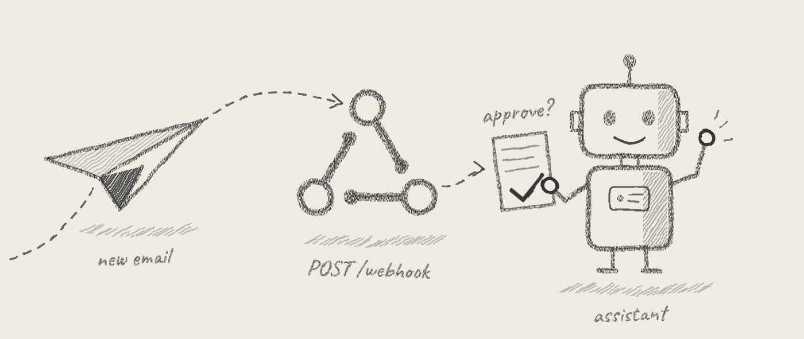
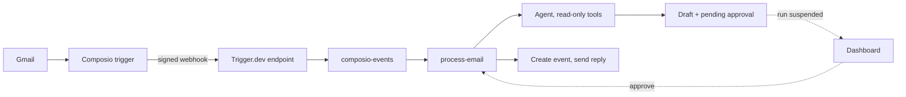

<p align="center">
  
</p>

<h1 align="center">trigger.dev &lt;&gt; composio</h1>

<p align="center">
  <b>A webhook-driven AI executive assistant.</b><br>
  New email → drafted reply and invite → <i>you approve</i> → sent.
</p>

<p align="center">
  
  
  
  
  
  <a href="LICENSE"></a>
</p>

An email lands in Gmail. Composio sends it to a Trigger.dev **native inbound webhook**.
An agent drafts a reply and a meeting time, then the run pauses until you approve it
in a small dashboard.

There is no webhook route in the Next.js app. Trigger.dev hosts the endpoint.

## How it works



| step | what happens | code |
| --- | --- | --- |
| Receive | Signature checked, retries deduped, other events filtered out | [`composio.ts`](src/trigger/composio.ts) |
| Intake | Self-sent, bulk and repeated mail dropped | [`intake.ts`](src/lib/events/intake.ts) |
| Propose | Agent reads the thread, calendar and company docs | [`analyze.ts`](src/lib/agent/analyze.ts) |
| Wait | Proposal hashed, Gmail draft created, run suspends | [`process-email.ts`](src/trigger/process-email.ts) |
| Decide | Edit, approve or reject. Owner only, once, before expiry | [`decide.ts`](src/lib/approvals/decide.ts) |
| Execute | Calendar rechecked, event created, draft sent, never twice | [`executor.ts`](src/lib/actions/executor.ts) |

## Features

- **Native webhooks.** Trigger.dev verifies, dedupes and tracks every delivery.
- **Durable approval.** A wait token, not a poll. It can wait for days.
- **Grounded replies.** Prices and policies come from [`demo-data/`](demo-data).
- **Read-only agent.** The model never gets a tool that sends or schedules.
- **Editable replies.** Each edit is a new version with its own hash and draft.
- **Calendar recheck.** If the slot was taken while waiting, nothing is sent.
- **Honest failures.** "Event created, reply not sent" is reported as that.
- **Traces.** Model calls, tool calls and actions show up in the run.

It also answers product questions, drafts a holding reply for escalations, and
skips mail that needs no reply.

## Quickstart

Needs Node 22, pnpm, Docker, a [Trigger.dev](https://trigger.dev) project, a
[Composio](https://composio.dev) project and an Anthropic API key.

```bash
git clone https://github.com/shricodev/executive-assistant-triggerdev-composio
cd executive-assistant-triggerdev-composio
pnpm install

cp .env.example .env.local   # fill it in
docker compose up -d         # Postgres on localhost:5434
pnpm db:migrate

npx trigger.dev@latest login
pnpm trigger:dev             # terminal 1
pnpm webhooks:setup          # once
pnpm dev                     # terminal 2, http://localhost:3000
```

Then open the dashboard, create the owner account, and connect Gmail and Google
Calendar under **Settings**. Connect them there, not in Composio's own dashboard:
the app also creates the Gmail trigger.

## Environment

| variable | notes |
| --- | --- |
| `DATABASE_URL` | Postgres connection string |
| `APP_URL` | public URL of the dashboard |
| `BETTER_AUTH_SECRET` | `openssl rand -base64 32` |
| `ALLOWED_EMAILS` | addresses allowed to sign up |
| `TRIGGER_SECRET_KEY` | dev key locally, prod key in production |
| `TRIGGER_PROJECT_REF` | `proj_...` |
| `COMPOSIO_API_KEY` | use a project dedicated to this app |
| `ANTHROPIC_API_KEY` | |
| `AI_MODEL` | default `claude-sonnet-5-5` |
| `AI_TRACE_CONTENT` | record prompts on spans. On in dev, off in prod |
| `APPROVAL_TTL_HOURS` | default `48` |

## Webhook setup

```bash
pnpm webhooks:setup
```

This reads the endpoint URL from Trigger.dev, sets it as the Composio webhook
(payload V3), and stores Composio's signing secret on the endpoint. The secret
never touches task code or `.env`.

Each environment has its own URL, including dev, so no tunnel is needed. A
Composio project has one webhook. If it already points elsewhere the script
stops; pass `--force` to replace it.

## Try it

1. From another account, email the connected inbox: *"Could you share pricing
   for a 20-person team? Are you free for a call next week?"*
2. In Trigger.dev, open **Webhooks → composio**. The delivery links to its run.
3. Open the `process-email` run to see the model and tool spans. It is waiting.
4. In the dashboard, open the proposal under **Approvals**. Edit it if you like.
5. Click **Approve and send**. The event is created and the reply goes out.

## Checks

```bash
pnpm test        # Vitest on an in-memory Postgres, no network
pnpm typecheck && pnpm lint && pnpm build
```

## Deploy

1. **Database.** Create a Postgres both services can reach, then
   `DATABASE_URL=... pnpm db:migrate`.
2. **Tasks.** Add `DATABASE_URL`, `APP_URL`, `COMPOSIO_API_KEY` and
   `ANTHROPIC_API_KEY` to the Trigger.dev prod environment, then
   `pnpm trigger:deploy`.
3. **Dashboard.** Deploy the Next.js app with every variable above, using the
   prod `TRIGGER_SECRET_KEY`.
4. **Webhook.** With a separate Composio project:
   `TRIGGER_SECRET_KEY=tr_prod_... COMPOSIO_API_KEY=... pnpm webhooks:setup`.

## License

[Apache 2.0](LICENSE). Larkspur AI and everything in `demo-data/` is fictional.
