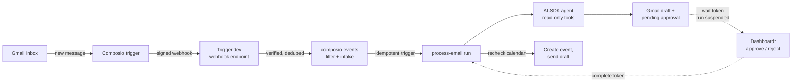

<p align="center">
  
</p>

<h1 align="center">aide</h1>

<p align="center">
  <b>A webhook-driven AI executive assistant built on Trigger.dev and Composio.</b><br>
  New Gmail message → drafted reply and meeting invite → <i>you approve</i> → sent.
</p>

<p align="center">
  
  
  
  
  <a href="LICENSE"></a>
</p>

aide watches a founder's inbox. When an email arrives, Composio sends an event to a
Trigger.dev **native inbound webhook**. Trigger.dev verifies it, dedupes it and starts a run.
An agent reads the thread, looks up pricing and policy in the company's own documents, checks
Google Calendar, and proposes a reply and a meeting time.

Then the run stops. It stays suspended, for days if needed, until a human approves or rejects
the proposal in a small dashboard. On approval it wakes up, checks the calendar again, and
sends exactly what was approved.

There is no webhook route in the Next.js app. Trigger.dev hosts the endpoint.

## How it works



1. **Receive.** [`src/trigger/composio.ts`](src/trigger/composio.ts) declares the endpoint with
   `webhooks.composio()` and a `webhook()` task that subscribes to it. Trigger.dev checks
   Composio's signature and drops retries that carry the same `webhook-id`. A filter keeps
   everything except new Gmail messages from starting a run.
2. **Intake.** [`intake.ts`](src/lib/events/intake.ts) validates the payload, matches the
   connected account to a user, and drops mail the owner sent themselves, bulk mail and
   automated senders. Two unique constraints make a repeated event or a second event for the
   same message a no-op.
3. **Propose.** [`process-email.ts`](src/trigger/process-email.ts) runs one agent
   ([`analyze.ts`](src/lib/agent/analyze.ts)) with three read-only tools: the Gmail thread,
   calendar free/busy, and the company documents in [`demo-data/`](demo-data). Code, not the
   prompt, sets the recipient and validates the meeting time
   ([`output.ts`](src/lib/agent/output.ts)).
4. **Wait.** The proposal is stored with a content hash, a Gmail draft is created, and the run
   suspends on `wait.forToken()`.
5. **Decide.** The dashboard calls [`decide()`](src/lib/approvals/decide.ts): owner only,
   once only, before expiry, for the exact hash that was shown. Then `wait.completeToken()`
   resumes the run. Editing the reply first goes through
   [`reviseReply()`](src/lib/approvals/revise.ts) under the same rules.
6. **Execute.** The run rechecks availability, then creates the event and sends the draft
   through [`runAction()`](src/lib/actions/executor.ts), which never performs the same side
   effect twice, including after a crash.

## What it does

- **Native webhook intake**: verification, deduplication and delivery tracking are done by
  Trigger.dev. Every delivery links to the run it started.
- **Durable human approval**: the wait is a Trigger.dev wait token, not a poll or an open
  request. A proposal expires after `APPROVAL_TTL_HOURS`.
- **Grounded replies**: prices and policies come from Markdown files in the repo. A reply
  written without reading them is rejected before a human sees it.
- **Restricted tools**: the model only ever gets read-only tools. Sending and scheduling are
  called from code, after approval, through a separate Composio session.
- **Immutable approvals**: you approve a hash. If the Gmail draft was edited afterwards, it is
  not sent.
- **Editable replies**: change the wording in the dashboard before you approve. The edit is
  stored as a new version with its own hash and Gmail draft, the old version is kept as
  replaced, and the same suspended run picks up whichever version you decide on.
- **Calendar recheck**: if the slot was booked while the proposal waited, nothing is sent and
  a new proposal is drafted once.
- **Honest failure states**: each action records its own outcome, so "event created, reply
  not sent" is reported as exactly that.
- **Traces**: AI SDK telemetry puts every model call and tool call in the Trigger.dev run
  trace.

It also answers plain product questions, drafts a holding reply for customer escalations (no
meeting, flagged high priority) and skips mail that needs no reply.

## Quickstart

You need Node 22, pnpm, Docker, a [Trigger.dev](https://trigger.dev) project, a
[Composio](https://composio.dev) project and an Anthropic API key.

```bash
git clone https://github.com/shricodev/executive-assistant-triggerdev-composio
cd executive-assistant-triggerdev-composio
pnpm install

cp .env.example .env.local        # fill it in, see below
docker compose up -d              # Postgres on localhost:5434
pnpm db:migrate

npx trigger.dev@latest login
pnpm trigger:dev                  # terminal 1: registers the webhook endpoint
pnpm webhooks:setup               # once: points Composio at Trigger.dev
pnpm dev                          # terminal 2: dashboard on http://localhost:3000
```

Open the dashboard, create the owner account, and connect Gmail and Google Calendar under
**Settings**.

## Environment

| variable | used by | notes |
| --- | --- | --- |
| `DATABASE_URL` | app, tasks | Postgres connection string |
| `APP_URL` | app, tasks | public URL of the dashboard |
| `BETTER_AUTH_SECRET` | app | `openssl rand -base64 32` |
| `ALLOWED_EMAILS` | app | comma-separated addresses allowed to sign up |
| `TRIGGER_SECRET_KEY` | app, setup script | per environment: dev key locally, prod key in production |
| `TRIGGER_PROJECT_REF` | CLI, app | `proj_...`; also enables run links in the dashboard |
| `COMPOSIO_API_KEY` | app, tasks, setup script | use a project dedicated to this app |
| `ANTHROPIC_API_KEY` | tasks | |
| `AI_MODEL` | tasks | defaults to `claude-sonnet-5-5` |
| `AI_TRACE_CONTENT` | tasks | record prompts and completions on spans; on in dev, off in prod |
| `APPROVAL_TTL_HOURS` | tasks | defaults to `48` |

Configuration is validated with Zod when the app starts and when a task first needs it. A
missing variable fails with its name.

## Connect Composio

Accounts are connected from the dashboard, not from a script.

1. Sign in and open **Settings**.
2. Click **Connect** next to Gmail and complete Google's consent screen. This uses Composio's
   managed OAuth, so there is no Google Cloud project to create.
3. Do the same for Google Calendar. It is optional: without it the assistant replies but does
   not propose meeting times.

Connecting Gmail also creates a `GMAIL_NEW_GMAIL_MESSAGE` trigger for that account, limited to
the inbox. Composio reports whether the trigger is realtime or polling-backed, and Settings
shows which one you got.

## Trigger.dev webhook setup

The endpoint is declared in code, so it exists as soon as `pnpm trigger:dev` (or a deploy) has
run once. Each environment gets its own URL, including dev, so no tunnel is needed.

```bash
pnpm webhooks:setup
```

This reads the endpoint URL from Trigger.dev, sets it as the Composio project's webhook
subscription (payload version V3), and stores the signing secret Composio returns on the
Trigger.dev endpoint. The secret never touches task code or `.env`.

A Composio project has one webhook subscription. If the project already delivers somewhere
else the script stops and tells you; pass `--force` to replace it.

To do it by hand instead: copy the URL from **Webhooks → composio** in the Trigger.dev
dashboard, set it as the webhook URL in Composio, and paste Composio's signing secret into
**Set signing secret** on the endpoint.

## Local development

```bash
pnpm dev            # Next.js dashboard
pnpm trigger:dev    # Trigger.dev tasks, with live reload

pnpm test           # Vitest: intake, approvals, executor, proposal guards
pnpm typecheck
pnpm lint
pnpm build
```

Tests run against an in-memory Postgres ([PGlite](https://pglite.dev)) with the real
migrations applied, so the unique constraints and compare-and-swap updates behave as they do
in production. No test touches Gmail, Calendar, Composio or a model.

After changing [`src/db/schema.ts`](src/db/schema.ts), run `pnpm db:generate` and
`pnpm db:migrate`.

## Deploy

The app is three pieces: a Postgres database, the Trigger.dev tasks and the Next.js dashboard.

1. **Database.** Create a Postgres database that both Trigger.dev and your web host can reach.
   Run `DATABASE_URL=... pnpm db:migrate`.
2. **Tasks.** In the Trigger.dev dashboard, add `DATABASE_URL`, `APP_URL`, `COMPOSIO_API_KEY`,
   `ANTHROPIC_API_KEY`, and optionally `AI_MODEL` and `APPROVAL_TTL_HOURS`, to the production
   environment. Then:
   ```bash
   pnpm trigger:deploy
   ```
3. **Dashboard.** Deploy the Next.js app to Vercel or any Node host with every variable from
   the table above. Use the **production** `TRIGGER_SECRET_KEY` and set `APP_URL` to the
   public URL.
4. **Webhook.** Use a separate Composio project for production, then run the setup script
   against production:
   ```bash
   TRIGGER_SECRET_KEY=tr_prod_... COMPOSIO_API_KEY=... pnpm webhooks:setup
   ```
5. **Accounts.** Sign up with an address from `ALLOWED_EMAILS` and connect Gmail and Calendar.

## Verify it works

1. From another account, email the connected inbox: *"Could you share pricing for a 20-person
   team? Are you free for a call next week?"*
2. In Trigger.dev, open **Webhooks → composio → Deliveries**. The delivery is there with its
   payload and a link to the `composio-events` run.
3. That run triggers `process-email`. Open it and expand the AI spans to see the model calls
   and the `getCompanyContext`, `GMAIL_FETCH_MESSAGE_BY_THREAD_ID` and
   `GOOGLECALENDAR_FREE_BUSY_QUERY` tool calls. The run then shows as waiting.
4. In the dashboard, **Approvals** shows the proposal. A matching draft is in Gmail.
5. Click **Approve and send**. The run resumes, and the page updates with links to the sent
   reply and the calendar event.
6. Send the same kind of email again and click **Reject**. The draft disappears and nothing is
   sent.

## Layout

```
src/
  trigger/     composio.ts (endpoint + webhook task), process-email.ts (workflow)
  lib/
    events/    payload schema, filters, deduplicating intake
    agent/     prompt, tools, AI SDK call, proposal schema and guards
    approvals/ state machine, decide(), reviseReply()
    actions/   idempotent executor, Gmail and Calendar handlers
    composio/  client, tool allowlists, connections, Gmail and Calendar calls
  app/         Next.js dashboard: overview, approvals, activity, settings
  db/          Drizzle schema
demo-data/     the fictional company's documents
scripts/       migrate, webhook setup
drizzle/       SQL migrations
```

## License

[Apache 2.0](LICENSE). Larkspur AI, its product, prices and people in `demo-data/` are
fictional.
